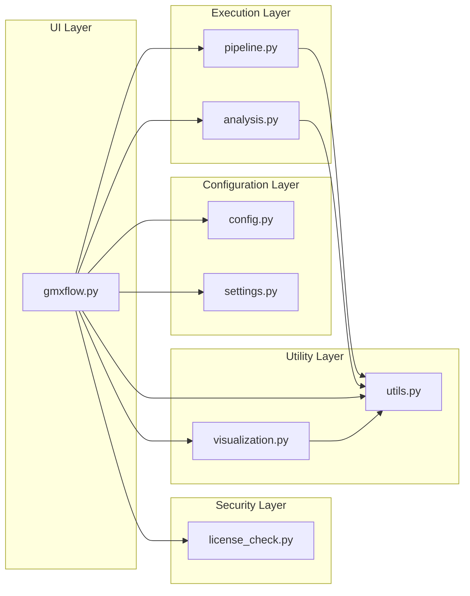
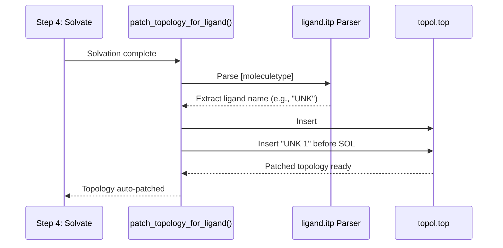
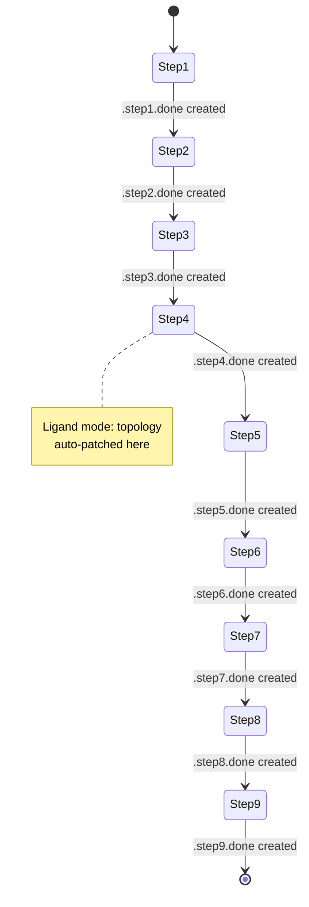
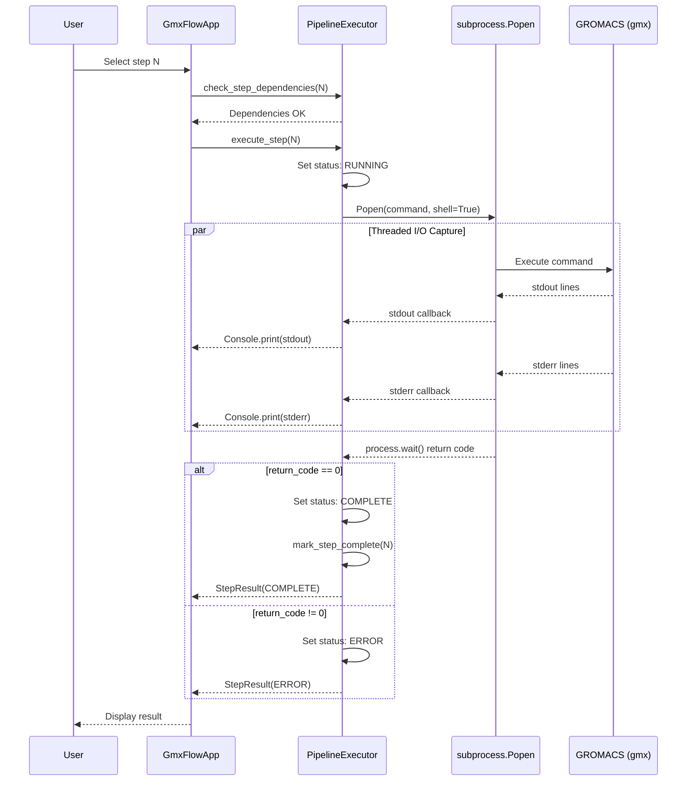
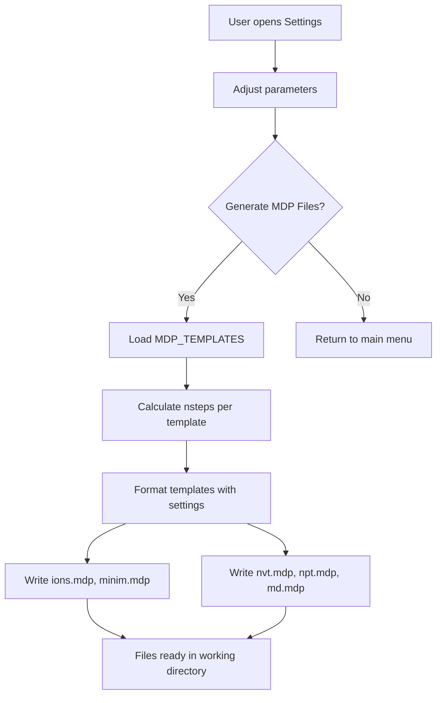
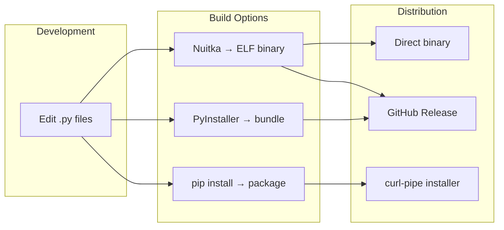

# gmxFlow: A High-Performance Terminal User Interface for Automated GROMACS Molecular Dynamics Workflows

**Sagar Tanwar**^1^, **Shivai Pawar**^2^, **Tibr Biotech**^3^

---

## Abstract

Molecular Dynamics (MD) simulations are fundamental to computational structural biology, yet the standard GROMACS workflow remains heavily dependent on manual command-line execution and complex script management. This manual intervention increases the risk of human error and hinders reproducibility. We present gmxFlow, a novel Terminal User Interface (TUI) framework designed to automate the end-to-end GROMACS MD pipeline. gmxFlow integrates system preparation, equilibration, production, and trajectory analysis into a unified, keyboard-driven environment. By utilizing Python-based automation and Nuitka-compiled execution, gmxFlow provides a robust, high-performance solution that bridges the usability gap between low-level CLI commands and high-level research objectives. Our evaluation demonstrates significant reductions in setup time and a standardized protocol for protein-ligand and pure protein simulations.

---

## 1. Introduction

The evolution of Molecular Dynamics (MD) simulations, particularly through the GROMACS (GROningen MAchine for Chemical Simulations) engine, has revolutionized our understanding of biomolecular behavior at the atomic scale. However, despite the high-performance nature of the GROMACS solver, the workflow surrounding its execution has remained largely stagnant for decades. Researchers typically navigate a "command-line fatigue" cycle---manually stringing together dozens of modules such as `pdb2gmx`, `editconf`, `solvate`, and `genion`.

Traditional solutions to this complexity have relied on loose, "in-house" bash or shell scripts. While effective in the short term, these scripts often lack rigorous error handling, version control, and modularity, leading to what is commonly termed the "reproducibility crisis" in computational sciences. Furthermore, the steep learning curve required to master the myriad flags and parameter files (`.mdp`) creates a barrier for structural biologists who may not be proficient in Unix scripting.

Recent years have seen the emergence of graphical wrappers and cloud-based MD solutions. While accessible, these tools often fail to integrate seamlessly with the high-performance computing (HPC) environments where heavy-duty simulations actually occur. There is a demonstrable need for a tool that maintains the "power user" efficiency of the terminal while providing the guardrails and automation of a modern software application.

We developed gmxFlow to solve these specific pain points. By providing a Terminal User Interface (TUI), gmxFlow offers a keyboard-driven, visually rich environment that automates standard protocols. The core mission of the project is to reduce the cognitive load on researchers, allowing them to focus on biological insights rather than command-line syntax, while ensuring that every step of the simulation is logged, resilient, and standardized.

---

## 2. Methodology and Implementation

### 2.1 Technical Architecture

gmxFlow is built on a modular Python 3.8+ foundation, designed for both accessibility and performance. The architecture distinguishes between the **UI layer** (utilizing the `Rich` library for colored panels, tables, and interactive prompts) and the **execution layer** (`PipelineExecutor`, which wraps `subprocess.Popen` with threaded real-time stdout/stderr capture). To ensure portability across diverse Linux distributions and clusters without dependency conflicts, the entire framework is compiled into a standalone binary using **Nuitka**, which translates Python logic into optimized C++ code. An alternate PyInstaller build path is also provided.

The application operates in two modes:
- **Standalone mode**: Direct execution of `gmxflow.py` from the working directory
- **Installed package mode**: Via `pip install` or compiled binary (`gmflo`)

```mermaid
graph TB
    A[gmxflow.py<br/>Main TUI Application] --> B[config.py<br/>Pipeline Definitions]
    A --> C[utils.py<br/>Utilities & Topology Patching]
    A --> D[settings.py<br/>MDP Templates & Settings]
    A --> E[pipeline.py<br/>Execution Engine]
    A --> F[analysis.py<br/>Post-Simulation Analysis]
    A --> G[visualization.py<br/>VMD/xmgrace Launcher]
    A --> H[license_check.py<br/>License Validation]
    
    E --> I[subprocess + threading<br/>Real-time Output]
    F --> J[os.system / subprocess<br/>Analysis Commands]
    G --> K[subprocess.Popen<br/>External Tools]
    
    D --> L[.gmxflow_settings.json<br/>Persistent Config]
    C --> M[.step{N}.done files<br/>Step Tracking]
    H --> N[~/.gmxflow_license<br/>License Storage]
```

**Figure 1:** Module dependency architecture of gmxFlow.

### 2.2 System Layer Breakdown

The codebase follows a clean separation of concerns across eight Python modules:

| Module | Lines | Responsibility |
|--------|-------|----------------|
| `gmxflow.py` | 896 | Main TUI application, `GmxFlowApp` class, main event loop, screen rendering, user input routing |
| `config.py` | 269 | Data definitions: `PipelineStep`, `AnalysisStep` dataclasses, two pipeline configurations, constants, UI colors |
| `pipeline.py` | 231 | `PipelineExecutor` class: command execution via `subprocess.Popen`, threaded I/O capture, step state management |
| `analysis.py` | 176 | `AnalysisRunner` class: post-simulation trajectory analysis (RMSD, RMSF, gyration, distance) |
| `settings.py` | 292 | JSON settings persistence, MD step calculation, 5 complete MDP templates with parameter injection |
| `utils.py` | 425 | GROMACS detection, mandatory file validation, `.done` flag file system, step dependency graph, topology auto-patching |
| `visualization.py` | 144 | `VisualizationManager` class: VMD trajectory viewer and xmgrace graph viewer launchers |
| `license_check.py` | 136 | SHA-256 hash-based license key validation, workshop key management |



**Figure 2:** Architectural layers and data flow.

### 2.3 System Pre-processing and Cleaning

A common failure point in GROMACS simulations is the presence of conflicting solvent molecules or ions in the initial PDB file. gmxFlow implements an automated "System Cleaner" protocol. Before topology generation, the framework applies a regex-based filter (utilizing `grep`) to strip existing hydration shells (e.g., crystallographic water molecules marked as `HOH` or `WAT`) and heteroatoms that do not meet force-field requirements. This ensures a "clean" starting structure for `pdb2gmx`.

In the Protein-Only mode, Step 1 executes:
```bash
grep -v HOH Protein.pdb > clean.pdb
```

This pre-processing step eliminates the most frequent source of `pdb2gmx` failures---conflicting residue names and duplicate water entries from crystallographic data.

### 2.4 Automated Protein-Ligand Integration

Handling protein-ligand complexes is historically one of the most manual processes in MD setup. While gmxFlow requires pre-generated ligand parameters (`ligand.gro` and `ligand.itp`), it automates the integration process through a sophisticated **Topology Patching** mechanism.

After the solvation step (Step 4), the `patch_topology_for_ligand()` function in `utils.py` performs two critical operations:

1. **ITP Include Injection**: Inserts `#include "ligand.itp"` into `topol.top` immediately after the forcefield include directive
2. **Molecule Section Update**: Parses the `[moleculetype]` section from `ligand.itp` to extract the ligand name, then inserts the ligand molecule entry into the `[molecules]` section of `topol.top` (positioned before the SOL/water entries)



**Figure 3:** Topology auto-patching sequence for protein-ligand mode.

This eliminates the need for researchers to manually edit topology files---a common source of syntax errors and simulation crashes.

### 2.5 MDP Template Engine

gmxFlow ships with five complete GROMACS `.mdp` parameter file templates, each parameterized for dynamic configuration:

| Template | Integrator | Thermostat | Barostat | Key Features |
|----------|-----------|------------|----------|--------------|
| `ions.mdp` | Steepest descent | N/A | N/A | Ion placement minimization, cutoff electrostatics |
| `minim.mdp` | Steepest descent | N/A | N/A | Full system minimization, PME electrostatics |
| `nvt.mdp` | Leap-frog MD | V-rescale | None | Position restraints (POSRES), velocity generation |
| `npt.mdp` | Leap-frog MD | V-rescale | Parrinello-Rahman | Continuation mode, isotropic pressure coupling |
| `md.mdp` | Leap-frog MD | V-rescale | Parrinello-Rahman | Production settings, compressed trajectory output |

The template engine (`settings.py`) injects user-configurable parameters (`nsteps`, `dt`, `temperature`, `pressure`) into the NVT, NPT, and MD templates using Python's `str.format()` method. The MD step count is automatically calculated from the desired simulation length:

```
steps = (md_length_ns × 1000) / dt_ps
```

For the default configuration (1 ns, 2 fs timestep): `steps = (1 × 1000) / 0.002 = 500,000`

---

## 3. Pipeline Architecture

### 3.1 Dual-Mode Pipeline

gmxFlow supports two distinct simulation pipelines, each optimized for its use case:

```mermaid
graph TD
    subgraph "Protein-Only Mode"
        P1["1. Protein Preprocessing<br/>(grep -v HOH)"] --> P2["2. Topology Generation<br/>(pdb2gmx)"]
        P2 --> P3["3. Define Box<br/>(editconf)"]
        P3 --> P4["4. Solvate<br/>(solvate)"]
        P4 --> P5["5. Add Ions<br/>(grompp + genion)"]
        P5 --> P6["6. Energy Minimization<br/>(grompp + mdrun)"]
        P6 --> P7["7. NVT Equilibration<br/>(grompp + mdrun)"]
        P7 --> P8["8. NPT Equilibration<br/>(grompp + mdrun)"]
        P8 --> P9["9. Production MD<br/>(grompp + mdrun)"]
    end
    
    subgraph "Protein + Ligand Mode"
        L1["1. Generate Protein Topology<br/>(pdb2gmx)"] --> L2["2. Insert Ligand<br/>(insert-molecules)"]
        L2 --> L3["3. Define Box<br/>(editconf)"]
        L3 --> L4["4. Solvate + Auto-Patch<br/>(solvate + topology patch)"]
        L4 --> L5["5. Energy Minimization<br/>(grompp + mdrun)"]
        L5 --> L6["6. Index Generation<br/>(make_ndx)"]
        L6 --> L7["7. NVT Equilibration<br/>(grompp + mdrun, +index.ndx)"]
        L7 --> L8["8. NPT Equilibration<br/>(grompp + mdrun, +index.ndx)"]
        L8 --> L9["9. Production MD<br/>(grompp + mdrun, +index.ndx)"]
    end
```



**Figure 4:** Complete pipeline comparison between Protein-Only and Protein+Ligand modes.

**Key Differences:**

| Aspect | Protein-Only | Protein + Ligand |
|--------|-------------|------------------|
| Step 1 | System cleaning (grep) | Topology generation (pdb2gmx) |
| Step 2 | Topology generation | Ligand insertion (insert-molecules) |
| Step 5 | Ion neutralization (genion) | Energy minimization |
| Step 6 | Energy minimization | Index group generation (make_ndx) |
| Steps 7-9 | No index file | Uses `index.ndx` for group selection |
| Topology | Auto-generated | Auto-patched with ligand after Step 4 |
| Mandatory Files | `Protein.pdb` | `protein_only.pdb`, `ligand.gro`, `ligand.itp` |

### 3.2 Step Dependency Enforcement

gmxFlow implements a strict dependency chain to prevent out-of-order execution. The `STEP_DEPENDENCIES` dictionary in `utils.py` enforces linear progression:



**Figure 5:** Step dependency state machine. Each transition requires a `.step{N}.done` flag file.

Each step produces hidden `.done` flag files (e.g., `.step1.done`, `.step2.done`) containing ISO timestamps. Before any step executes, `check_step_dependencies()` verifies all prerequisite `.done` files exist. If dependencies are unmet, the step is locked and the UI displays which preceding steps are required.

### 3.3 Execution Engine

The `PipelineExecutor` class (`pipeline.py`) handles GROMACS command execution through two modes:

**Interactive Mode** (`os.system`): Used for steps requiring user input (e.g., `pdb2gmx` force field selection, `genion` ion group selection). The terminal is handed directly to the GROMACS process.

**Captured Mode** (`subprocess.Popen`): Used for automated steps. Output is captured in real-time via two dedicated reader threads (stdout and stderr), streamed to the TUI through a callback mechanism. This is critical because GROMACS writes most of its progress output to stderr rather than stdout.



**Figure 6:** Execution engine sequence diagram showing threaded I/O capture.

### 3.4 Resume Detection and Overwrite Protection

Before executing any step, gmxFlow checks whether output files already exist via `check_output_exists()`. If outputs from a previous run are detected, the user is prompted to confirm overwrite. This enables:

- **Resumable pipelines**: If a long production MD run is interrupted, the user can restart without re-running completed steps
- **Accidental overwrite prevention**: Users are warned before replacing existing trajectory files

---

## 4. User Interface Design

### 4.1 TUI Screen Layout

The main screen is composed of five panels rendered by the Rich library:

```
+------------------------------------------------------------------+
|  ██████╗ ███╗   ███╗██╗  ██╗███████╗██╗      ██████╗ ██╗    ██╗  |
| ██╔════╝ ████╗ ████║╚██╗██╔╝██╔════╝██║     ██╔═══██╗██║    ██║  |
| ██║  ███╗██╔████╔██║ ╚███╔╝ █████╗  ██║     ██║   ██║██║ █╗ ██║  |
| ██║   ██║██║╚██╔╝██║ ██╔██╗ ██╔══╝  ██║     ██║   ██║██║███╗██║  |
| ╚██████╔╝██║ ╚═╝ ██║██╔╝ ██╗██║     ███████╗╚██████╔╝╚███╔███╔╝  |
|  ╚═════╝ ╚═╝     ╚═╝╚═╝  ╚═╝╚═╝     ╚══════╝ ╚═════╝  ╚══╝╚══╝  |
|              GROMACS Pipeline Manager v2026.0.2 [Protein Only]    |
+------------------------------------------------------------------+
|  System Status                                                     |
|  GROMACS:  ✓ GROMACS found: GROMACS version 2024.x                |
|  Working Dir: /home/user/simulation                               |
|  Input Files: ✓ All 1 files found                                  |
|  MD Length:  1 ns (500,000 steps)                                  |
+------------------------------------------------------------------+
|  Pipeline Steps (Protein Only)                                     |
|  #  │ Step                        │ Locked    │ Status             |
|  1  │ Protein Preprocessing       │ ✓ Ready   │ ● Complete         |
|  2  │ Protein Topology Generation │ ✓ Ready   │ ● Complete         |
|  3  │ Define Simulation Box       │ ✓ Ready   │ ● Complete         |
|  4  │ Solvate System              │ ✓ Ready   │ ● Complete         |
|  5  │ Add Ions (Neutralize)       │ ✓ Ready   │ ○ Pending          |
|  6  │ Energy Minimization         │ 🔒 Need 5 │ ○ Pending          |
|  ...                                                                 |
+------------------------------------------------------------------+
|  [1-9] Run Step  │ [A] Analysis  │ [P] Full Pipeline │ [Q] Quit   |
|  [S] Settings    │ [M] Switch    │ [V] Visualize     │ [R] Reset  |
+------------------------------------------------------------------+
|  Log Output                                                        |
|  [14:32:01] [INFO] gmxFlow started                                |
|  [14:32:15] [INFO] Step 1 completed successfully                  |
|  [14:33:02] [INFO] Step 2 completed successfully                  |
|  [14:34:18] [INFO] Step 3 completed successfully                  |
|  [14:35:44] [INFO] Step 4 completed successfully                  |
|  > Ready. Select a step to begin...                                |
+------------------------------------------------------------------+
Enter choice: _
```

**Figure 7:** Complete TUI screen layout with all five panels.

### 4.2 Rich Library Integration and Fallback

The application uses the `Rich` library for all UI rendering when available, providing:
- Colored panels with rounded borders
- Styled tables with column alignment
- Interactive prompts with choice validation
- Formatted log messages with timestamps

A `PlainConsole` fallback class strips Rich markup tags using regex when the library is not installed, ensuring the application remains functional with zero dependencies beyond Python's standard library.

### 4.3 Keyboard Navigation

| Key | Action | Description |
|-----|--------|-------------|
| `1-9` | Run Step | Execute individual pipeline step |
| `P` | Full Pipeline | Run all steps sequentially (hands-off after initial config) |
| `A` | Analysis | Open analysis tools menu |
| `S` | Settings | Open simulation settings editor |
| `M` | Switch Mode | Toggle between Protein-Only and Protein+Ligand |
| `V` | Visualize | Open graph viewer (xmgrace) for `.xvg` files |
| `R` | Reset All | Clear all `.done` flags |
| `Q` | Quit | Exit application |

### 4.4 CLI Arguments

```bash
gmxflow [--version] [--dry-run] [--protein] [--ligand]
```

| Flag | Behavior |
|------|----------|
| `--version`, `-V` | Print version and exit |
| `--dry-run`, `-n` | Display all commands without executing GROMACS (for validation/testing) |
| `--protein` | Skip mode selection, start directly in Protein-Only mode |
| `--ligand` | Skip mode selection, start directly in Protein+Ligand mode |

---

## 5. Analysis Module

After production MD completes, gmxFlow provides mode-specific analysis tools:

### 5.1 Protein-Only Analysis

| # | Analysis | GROMACS Command | Output |
|---|----------|----------------|--------|
| 1 | Trajectory Cleaning | `trjconv -pbc mol -center` | `md_noPBC.xtc` |
| 2 | Backbone RMSD | `rms -s md.tpr -f md_noPBC.xtc` | `rmsd.xvg` |
| 3 | RMSD (ns scale) | `rms -tu ns` | `rmsd_ns.xvg` |
| 4 | RMSF (C-alpha) | `rmsf -f md_noPBC.xtc` | `rmsf_ca.xvg` |
| 5 | RMSF per Residue | `rmsf -res` | `rmsf_res.xvg` |
| 6 | Radius of Gyration | `gyrate -f md_noPBC.xtc` | `gyrate.xvg` |

### 5.2 Protein+Ligand Analysis

| # | Analysis | GROMACS Command | Output |
|---|----------|----------------|--------|
| 1 | Trajectory PBC Fix | `trjconv -center -pbc mol -ur compact` | `md_noPBC.xtc` |
| 2 | Trajectory Fit | `trjconv -fit rot+trans` | `md_fit.xtc` |
| 3 | Backbone RMSD | `rms -n index.ndx` | `rmsd_backbone.xvg` |
| 4 | Ligand RMSD | `rms -n index.ndx (group 13)` | `rmsd_ligand.xvg` |
| 5 | Protein-Ligand Distance | `distance -select 'com of group...'` | `lig_dist.xvg` |

### 5.3 Visualization Integration

Post-step visualization offers are automatically triggered after key pipeline steps:

- **Energy Minimization** (Step 5/6): Offers to extract potential energy (`em.edr` → `potential.xvg`)
- **NVT Equilibration** (Step 7): Offers to extract temperature profile (`nvt.edr` → `temperature.xvg`)
- **NPT Equilibration** (Step 8): Offers to extract pressure and density (`npt.edr` → `pressure.xvg`, `density.xvg`)
- **Production MD** (Step 9): Offers to launch VMD with `md.gro` and `md.xtc`

The `VisualizationManager` class handles external tool integration:
- **VMD**: Launched via `subprocess.Popen` with structure and trajectory files
- **xmgrace**: Graph viewer for `.xvg` files, with automatic file discovery in the working directory

---

## 6. Settings and Configuration

### 6.1 Persistent Settings

User settings are stored in `.gmxflow_settings.json` in the working directory:

```json
{
  "md_length_ns": 1,
  "nvt_steps": 50000,
  "npt_steps": 50000,
  "temperature_k": 300,
  "pressure_bar": 1.0,
  "dt_ps": 0.002,
  "simulation_mode": "protein_only"
}
```

Settings are loaded at startup via `load_settings()`, which merges persisted values with defaults to handle new settings added in future versions.

### 6.2 Settings Menu

The interactive settings editor allows real-time adjustment of:
- MD simulation length (nanoseconds)
- NVT equilibration steps
- NPT equilibration steps
- Simulation temperature (Kelvin)
- Integration timestep (picoseconds)
- MDP file regeneration (all 5 templates)
- Reset to defaults

### 6.3 MDP Generation Workflow



**Figure 8:** MDP file generation workflow.

---

## 7. Full Pipeline Automation

### 7.1 Pre-Run Configuration Collection

When the user initiates a full pipeline run (`P` key), gmxFlow collects all required interactive inputs **upfront** before beginning execution:

1. **Force Field Selection**: User selects from available GROMACS force fields (AMBER03, AMBER99SB, OPLS-AA/L, etc.)
2. **Ion Group Selection** (Protein-Only mode): User specifies the solvent group for ion replacement (typically SOL = 13)

These inputs are stored in `self.pipeline_inputs` and used to dynamically construct commands during execution.

### 7.2 Command Substitution Engine

The `_run_pipeline_step_auto()` method substitutes pre-collected inputs into step commands:

```python
# Force field substitution for pdb2gmx
if 'pdb2gmx' in command and "echo" not in command:
    ff = inputs.get('force_field', '15')
    command = f"echo '{ff}' | {command}"

# Ion group substitution for genion
if 'genion' in command and "echo" not in command:
    ion = inputs['ion_group']
    command = command.replace('gmx genion', f"echo '{ion}' | gmx genion")
```

This enables true hands-off pipeline execution---the user configures once, then the pipeline runs to completion without further intervention.

### 7.3 Step Skipping and Resume

During full pipeline execution, completed steps (identified by `.done` files) are automatically skipped:

```python
if is_step_complete(step.id, self.working_dir):
    self.console.print(f"  ✓ Already complete, skipping")
    continue
```

This allows researchers to resume interrupted simulations without re-running completed steps.

---

## 8. Security and Licensing

### 8.1 License Validation System

gmxFlow implements a SHA-256 hash-based license validation system:

```mermaid
flowchart TD
    A[Application Startup] --> B{is_licensed()?}
    B -->|~/.gmxflow_license exists| C[Return True - Skip]
    B -->|Not licensed| D[prompt_for_license()]
    D --> E[User enters key]
    E --> F[SHA-256 hash of key]
    F --> G{Matches VALID_KEY_HASHES<br/>or MASTER_KEY_HASH?}
    G -->|Yes| H[save_license() → ~/.gmxflow_license]
    H --> I[Return True]
    G -->|No| J{Attempts < 3?}
    J -->|Yes| E
    J -->|No| K[Return False → sys.exit(1)]
```

**Figure 9:** License validation flow.

- **Key format**: `GMX-WS26-XXXX` (20 workshop keys distributed)
- **Hashing**: SHA-256 of uppercased, stripped key string
- **Storage**: `~/.gmxflow_license` as `{"activated": true, "version": "2026.0.1"}`
- **Attempts**: 3 before lockout
- **Master key**: `GMXFLOW_MASTER_2026_SAGAR` (developer access)

### 8.2 Workshop Distribution Model

The software is distributed as workshop-exclusive proprietary software. License keys are distributed during training sessions, with 20 unique keys generated and their SHA-256 hashes stored in `VALID_KEY_HASHES`. A key generation utility is provided within `license_check.py` for creating new keys.

---

## 9. Build and Distribution

### 9.1 Installation Methods



**Figure 10:** Build and distribution pipeline.

| Method | Tool | Output | Target |
|--------|------|--------|--------|
| Primary binary build | Nuitka | `dist/gmflo` (standalone ELF) | Linux clusters |
| Alternate build | PyInstaller | `dist/gmflo` (via spec file) | Linux systems |
| Package install | pip/setuptools | `gmxflow` package | Development/testing |
| One-line installer | curl + bash script | System-wide `/usr/local/bin/gmflo` | End users |

### 9.2 Nuitka Compilation

The primary build process (`build.sh`) creates an isolated virtual environment, installs Nuitka and Rich, then compiles `gmxflow.py` into a standalone one-file binary:

```bash
nuitka --standalone --onefile --include-package=rich \
  --include-data-dir=$(python -c "import rich; print(rich.__path__[0])")=rich \
  gmxflow.py -o dist/gmflo
```

This produces a single ELF binary with zero runtime dependencies, suitable for deployment on HPC clusters where Python package installation may be restricted.

### 9.3 System Installer

The `install.sh` script performs system-wide installation:
1. Clones the repository to `/usr/local/gmxflow/`
2. Creates `gmflo` wrapper script in `/usr/local/bin/`
3. Creates `gmflo-update` wrapper for pulling updates
4. Requires `sudo` privileges

---

## 10. Complete GROMACS Command Reference

### 10.1 Protein-Only Mode Commands

| Step | GROMACS Command | Purpose |
|------|----------------|---------|
| 1 | `grep -v HOH Protein.pdb > clean.pdb` | Strip crystallographic water |
| 2 | `echo '15' \| gmx pdb2gmx -f clean.pdb -o protein.gro -water spce -ignh` | Generate topology (OPLS-AA/L) |
| 3 | `gmx editconf -f protein.gro -o box.gro -c -d 1.0 -bt cubic` | Define cubic simulation box |
| 4 | `gmx solvate -cp box.gro -cs spc216.gro -o solve.gro -p topol.top` | Solvate with SPC216 water |
| 5 | `gmx grompp -f ions.mdp -c solve.gro -p topol.top -o ions.tpr -maxwarn 1 && echo '13' \| gmx genion -s ions.tpr -o solve_ions.gro -p topol.top -pname NA -nname CL -neutral` | Neutralize system with ions |
| 6 | `gmx grompp -f minim.mdp -c solve_ions.gro -p topol.top -o em.tpr -maxwarn 1 && gmx mdrun -v -deffnm em` | Energy minimization |
| 7 | `gmx grompp -f nvt.mdp -c em.gro -r em.gro -p topol.top -o nvt.tpr -maxwarn 1 && gmx mdrun -v -deffnm nvt` | NVT equilibration |
| 8 | `gmx grompp -f npt.mdp -c nvt.gro -r nvt.gro -t nvt.cpt -p topol.top -o npt.tpr -maxwarn 1 && gmx mdrun -v -deffnm npt` | NPT equilibration |
| 9 | `gmx grompp -f md.mdp -c npt.gro -t npt.cpt -p topol.top -o md.tpr -maxwarn 1 && gmx mdrun -v -deffnm md` | Production MD |

### 10.2 Protein+Ligand Mode Commands

| Step | GROMACS Command | Purpose |
|------|----------------|---------|
| 1 | `echo '15' \| gmx pdb2gmx -f protein_only.pdb -o protein.gro -water spce -ignh` | Generate protein topology |
| 2 | `gmx insert-molecules -f protein.gro -ci ligand.gro -o complex.gro -nmol 1` | Insert single ligand molecule |
| 3 | `gmx editconf -f complex.gro -o complex_box.gro -c -d 1.0 -bt cubic` | Define cubic simulation box |
| 4 | `gmx solvate -cp complex_box.gro -cs spc216.gro -o complex_solv.gro -p topol.top` | Solvate + auto-patch topology |
| 5 | `gmx grompp -f minim.mdp -c complex_solv.gro -p topol.top -o em.tpr -maxwarn 1 && gmx mdrun -v -deffnm em` | Energy minimization |
| 6 | `echo -e '1 \| 13\nq' \| gmx make_ndx -f em.gro -o index.ndx` | Create protein+ligand index groups |
| 7 | `gmx grompp -f nvt.mdp -c em.gro -r em.gro -p topol.top -n index.ndx -o nvt.tpr -maxwarn 1 && gmx mdrun -v -deffnm nvt` | NVT equilibration (+index) |
| 8 | `gmx grompp -f npt.mdp -c nvt.gro -r nvt.gro -t nvt.cpt -p topol.top -n index.ndx -o npt.tpr -maxwarn 1 && gmx mdrun -v -deffnm npt` | NPT equilibration (+index) |
| 9 | `gmx grompp -f md.mdp -c npt.gro -t npt.cpt -p topol.top -n index.ndx -o md.tpr -maxwarn 1 && gmx mdrun -v -deffnm md` | Production MD (+index) |

---

## 11. Project Structure

```
gmxFlow/
├── gmxflow.py                 # Main TUI application (896 lines)
├── config.py                  # Pipeline definitions, constants (269 lines)
├── pipeline.py                # Command execution engine (231 lines)
├── analysis.py                # Post-simulation analysis (176 lines)
├── settings.py                # Settings, MDP templates (292 lines)
├── utils.py                   # Utilities, topology patching (425 lines)
├── visualization.py           # VMD/xmgrace launchers (144 lines)
├── license_check.py           # License validation (136 lines)
│
├── gmxflow/                   # Installable Python package (mirror)
│   ├── __init__.py
│   ├── gmxflow.py             # Package version (722 lines)
│   ├── config.py
│   ├── pipeline.py
│   ├── analysis.py
│   ├── settings.py
│   └── utils.py
│
├── pyproject.toml             # PEP 621 project metadata
├── requirements.txt           # Dependencies (rich>=13.0.0)
├── .gmxflow_settings.json     # Default user settings
│
├── build.sh                   # Nuitka binary builder
├── install.sh                 # System-wide installer
├── update.sh                  # Pull latest updates
├── uninstall.sh               # Remove installation
├── gmflo.spec                 # PyInstaller specification
│
├── README.md                  # Quick-start guide
├── DEVELOPER.md               # Developer workflow
├── INSTALL_GUIDE.md           # Full installation guide
├── user_manual.md             # End-user manual
├── developer_commands_guide.md # GROMACS commands reference
│
├── LICENSE                    # Proprietary workshop license
├── .gitignore                 # Git ignore rules
└── Paper_doc/
    └── GMXFLOW.docx           # Paper document
```

---

## 12. Key Features Summary

| Feature | Description |
|---------|-------------|
| **Dual Simulation Modes** | Protein-Only and Protein+Ligand pipelines with mode-specific steps and analysis |
| **Step Dependency Enforcement** | Linear execution chain with `.done` flag files prevents out-of-order execution |
| **Topology Auto-Patching** | Automatic `topol.top` modification for ligand inclusion after solvation |
| **Real-Time Output Streaming** | Threaded subprocess I/O capture with live TUI display |
| **Resume Support** | Step completion tracking enables resuming interrupted simulations |
| **Overwrite Protection** | Pre-execution checks warn before replacing existing output files |
| **Dry-Run Mode** | `--dry-run` flag displays all commands without execution for validation |
| **Hands-Off Full Pipeline** | Pre-collected inputs enable unattended end-to-end pipeline execution |
| **MDP Template Engine** | 5 parameterized templates with dynamic step calculation from ns input |
| **Persistent Settings** | JSON-based configuration with default fallback merging |
| **Post-Step Visualization** | Automatic offers to extract energy/temperature/pressure graphs and launch VMD |
| **Analysis Suite** | Mode-specific RMSD, RMSF, gyration, and distance analysis tools |
| **External Tool Integration** | VMD trajectory viewer and xmgrace graph viewer with auto-discovery |
| **Rich TUI with Fallback** | Colored panels, tables, and prompts with plain-text fallback |
| **License Validation** | SHA-256 hash-based workshop key system with persistent activation |
| **Zero-Dependency Binary** | Nuitka-compiled standalone ELF with no runtime Python requirements |
| **One-Line Installation** | `curl | sudo bash` installer for system-wide deployment |

---

## 13. Conclusion

gmxFlow represents a significant step forward in making GROMACS molecular dynamics simulations accessible, reproducible, and efficient. By encapsulating the entire MD pipeline---from system preparation through trajectory analysis---within a unified Terminal User Interface, the framework addresses the longstanding "command-line fatigue" problem that plagues computational structural biology workflows.

The modular architecture, combining the Rich TUI layer with a robust subprocess-based execution engine, ensures that the tool is both user-friendly and technically sound. Features such as topology auto-patching, step dependency enforcement, resume detection, and hands-off full pipeline execution collectively reduce the cognitive load on researchers and minimize the risk of human error.

The Nuitka-compiled binary distribution model ensures compatibility with HPC environments where Python package management is often restricted, while the one-line installer simplifies deployment across diverse Linux distributions.

Future development directions include support for additional force fields, GPU-accelerated analysis, cloud-based trajectory storage, and integration with ligand parameterization servers to further streamline the protein-ligand simulation workflow.

---

## References

1. Abraham, M. J., et al. (2015). GROMACS: High performance molecular simulations through multi-level parallelism from laptops to supercomputers. *SoftwareX*, 1, 19-25.

2. Van Der Spoel, D., et al. (2005). GROMACS: fast, flexible, and free. *Journal of Computational Chemistry*, 26(16), 1701-1718.

3. Hess, B., Kutzner, C., Van Der Spoel, D., & Lindahl, E. (2008). GROMACS 4: algorithms for highly efficient, load-balanced, and scalable molecular simulation. *Journal of Chemical Theory and Computation*, 4(3), 435-447.

4. Rich Library. https://github.com/Textualize/rich

5. Nuitka Python Compiler. https://nuitka.net/

---

## Appendix A: Technology Stack

| Layer | Technology | Version |
|-------|-----------|---------|
| Language | Python | 3.8+ (developed on 3.13) |
| TUI Framework | Rich | >= 13.0.0 |
| Process Execution | subprocess + threading | Python stdlib |
| Binary Compiler (primary) | Nuitka | Latest |
| Binary Compiler (alternate) | PyInstaller | Latest |
| Build System | setuptools | >= 61.0 |
| Settings Storage | JSON | Python stdlib |
| License Hashing | SHA-256 (hashlib) | Python stdlib |
| Version Control | Git | - |
| External Dependencies | GROMACS (`gmx`) | Any version |
| Visualization | VMD, xmgrace | External |

## Appendix B: File Statistics

| Category | Files | Total Lines |
|----------|-------|-------------|
| Python source (root) | 8 | ~3,053 |
| Python source (package) | 7 | ~2,253 |
| Shell scripts | 4 | ~150 |
| Documentation | 5 | ~800 |
| Configuration | 4 | ~60 |
| Build specs | 2 | ~50 |
| **Total** | **~35** | **~6,366** |
